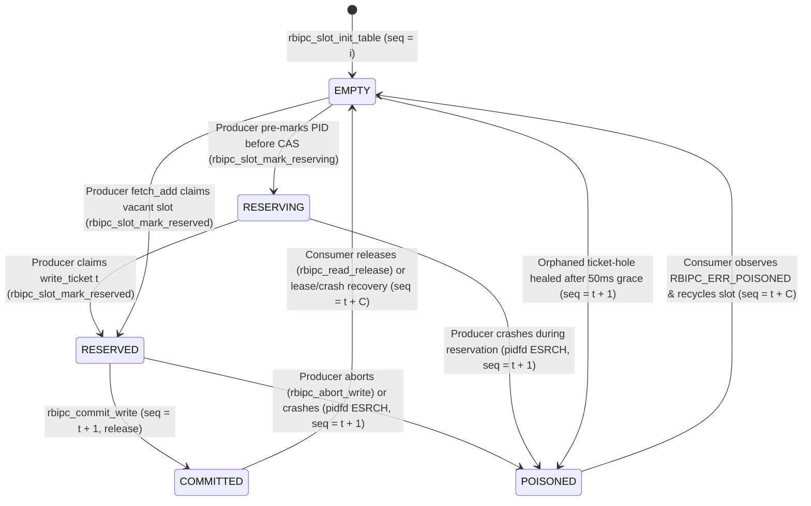

# Technical Report: Architecture, Formal Verification, and Empirical Evaluation of `librbipc`

**Author:** Christian Santarelli (`Seintian`)  
**Version:** 2.0.0 (`RBIPC_VERSION_MAJOR = 2`, `RBIPC_ABI_VERSION = 2`)  
**Language & Target:** ISO C23 (`-std=c23`) / Linux (`sys_futex`, `memfd_create`, `pidfd_open`, `eventfd`, `SCM_RIGHTS`)  
**License:** Apache License 2.0

---

## Abstract

Inter-Process Communication (IPC) on modern multi-core Linux systems forces systems architects into a binary trade-off between **CPU-burning busy-spin ring buffers** (such as DPDK `rte_ring` and the LMAX Disruptor with `BusySpinWaitStrategy`) and **kernel-mediated message transports** (such as POSIX `mqueue` and `AF_UNIX` domain sockets). Busy-spin designs achieve sub-microsecond latency (100–200 ns) and high throughput (17–22 Mops/s), but permanently consume 100% of a hardware execution thread per consumer even when the channel is completely idle. Conversely, kernel-mediated transports preserve 0% idle CPU utilization via kernel scheduler suspension, but incur two Ring-3 ↔ Ring-0 context switches, Virtual File System (VFS) lock acquisition, and two payload copies (`copy_from_user` / `copy_to_user`) on every message, capping single-stream throughput at 0.4–1.4 Mops/s and failing entirely on large payloads (`EMSGSIZE` above 8 KiB in default POSIX `mqueue`).

This report presents the design, formal concurrency model, fault-tolerance mechanisms, and empirical evaluation of **`librbipc`**, a zero-dependency C23 shared-memory IPC library that bridges this gap. `librbipc` synthesizes:
1. A **Vyukov-style per-slot 64-bit sequence turn array** ([`rbipc_slot_t`](include/rbipc.h)) decoupled from 32-bit process-shared Linux futex words, eliminating the ABA problem and 32-bit sequence wrap-around aliasing.
2. A **Dekker-synchronized, two-phase adaptive wait engine** ([`src/rbipc_sync.c`](src/rbipc_sync.c)) that executes a bounded user-space micro-spin (B = 48 `pause`/`yield` instructions, ≈ 400 ns) before transitioning into passive kernel `FUTEX_WAIT` suspension, achieving **100% syscall elision under sustained load** and **0.13% CPU utilization when idle**.
3. **Deterministic crash resilience** ([`src/rbipc_audit.c`](src/rbipc_audit.c)) using Linux 5.3+ `pidfd_open(2)` process descriptors to eliminate PID-recycling races, coupled with atomic slot poisoning (`RBIPC_SLOT_POISONED`), 50 ms orphaned ticket-hole healing, dead-consumer slot reclamation, and time-bounded consumer leases.
4. **Hardware-accelerated data paths**, including B-Queue scatter-gather vector batching ([`src/rbipc_batch.c`](src/rbipc_batch.c)) reaching **50.68 M msgs/s** (3.09 GB/s for 64 B frames), AVX2/NEON vectorized slot-readiness scanning ([`src/rbipc_simd.c`](src/rbipc_simd.c)), and non-temporal cache-bypassing streaming stores ([`src/rbipc_stream.c`](src/rbipc_stream.c)) reaching **19.87 GB/s** (+104.97% over `memcpy` at 1 MiB).
5. **Multi-topology IPC primitives**, including asynchronous `eventfd(2)`/`epoll(7)` reactor multiplexing ([`src/rbipc_reactor.c`](src/rbipc_reactor.c)), lock-free 1-to-N multicast publish-subscribe with non-blocking subscriber cursor clamping ([`src/rbipc_pubsub.c`](src/rbipc_pubsub.c)), and zero-namespace `memfd_create` capability passing over `AF_UNIX` `SCM_RIGHTS` ([`src/rbipc_ipc.c`](src/rbipc_ipc.c)).

---

## 1. Introduction & Design Philosophy

### 1.1 The Polling vs. Kernel-Mediated IPC Dichotomy

Modern low-latency systems—ranging from financial order-book matching engines and high-frequency telemetry collectors to autonomous robotics middleware—require inter-process communication primitives that simultaneously satisfy four constraints:
1. **High sustained throughput and low latency** via zero-copy shared-memory payload access in user space.
2. **Zero idle CPU consumption** (0% core burn during quiet periods) to coexist on multi-tenant hosts without thermal throttling or energy waste.
3. **Multi-Producer / Multi-Consumer (MPMC) scalability** across independent OS processes without lock convoys.
4. **Byzantine/crash fault isolation** so that an asynchronous `SIGKILL` or segmentation fault in any producer or consumer process mid-flight never deadlocks surviving peers or corrupts shared memory (`SIGBUS`).

Existing industrial frameworks optimize for only a subset of these constraints:
- **DPDK `rte_ring`** and the **LMAX Disruptor** assume dedicated, pinned CPU cores polling memory locations in an infinite loop. While effective when an entire core can be sacrificed per worker, busy-polling wastes 100% of core power during idle intervals and collapses under core over-subscription when the Linux Completely Fair Scheduler (CFS) preempts a lock-holder or next-in-line sequence publisher.
- **Kernel-mediated queues** (`mq_send`/`mq_receive`, `sendmsg`/`recvmsg` on `AF_UNIX`) delegate synchronization and buffering to the kernel, guaranteeing clean process isolation and passive sleep, but pay a fixed ~ 1.5–3.0 μs per-operation syscall and double-copy tax.
- **Publish-Subscribe middlewares** (such as Eclipse `iceoryx2`) provide zero-copy shared-memory loan semantics for 1-to-N broadcast topics, but require multi-file dynamic storage graphs (`/dev/shm/iox2_*`), do not natively implement competing-consumer work-queue distribution (`1\text{-of-}N` load balancing), and rely on external daemon or spin/clock-nanosleep notification patterns.

### 1.2 Architectural Contributions of `librbipc`

`librbipc` is architected from first principles in ISO C23 to unify competing-consumer MPMC work queues and 1-to-N multicast publish-subscribe within a single, self-contained shared-memory segment:

- **Unified Single-Descriptor Shared Memory Layout:** The control header ([`rbipc_shm_header_t`](include/rbipc.h)), slot descriptor table ([`rbipc_slot_t`](include/rbipc.h)), and payload buffer reside in a single page-aligned shared-memory object backed either by POSIX `/dev/shm` (`shm_open`) or an unlinked anonymous kernel inode (`memfd_create`) sealed against truncation (`F_SEAL_SHRINK | F_SEAL_GROW`).
- **Waiter-Guarded User-Space Fast Path:** When producers and consumers keep pace, all ticket allocations (`atomic_fetch_add`), payload writes, and sequence publications occur strictly in user space with **zero system calls**. A `SYS_futex` (`FUTEX_WAKE`) syscall is issued if and only if an atomic load of `futex_waiters` (or `write_waiters`) after a sequential-consistency (`memory_order_seq_cst`) Dekker fence observes a sleeping peer.
- **Role-Aware Crash Recovery:** Participating handles register explicit roles (`RBIPC_ROLE_PRODUCER`, `RBIPC_ROLE_CONSUMER`, `RBIPC_ROLE_MONITOR`) in the shared header (`active_producers`, `active_consumers`). Periodic 20 ms futex wake cycles (`RBIPC_FUTEX_PERIOD_NS`) allow blocked peers to audit the liveness of slot-holding PIDs via `pidfd_open(2)` and deterministically heal stalled slots.

### 1.3 System Decomposition

Following a strict Single-Responsibility Principle (SRP) decomposition, `librbipc` separates its public C/C++ ABI surface (`3` headers in `include/`) from `16` modular internal subsystems in `src/`:

| Layer | Module / Header | Responsibility & Key Algorithms |
| :--- | :--- | :--- |
| **Public ABI** | [`include/rbipc.h`](include/rbipc.h) | Core lifecycle, zero-copy slot I/O, B-Queue vector batching, streaming stores, `eventfd` reactor, and consumer lease APIs. |
| **Public ABI** | [`include/rbipc_ipc.h`](include/rbipc_ipc.h) | Capability-based file descriptor transfer (`rbipc_send_fd`, `rbipc_recv_fd_ex`) over `AF_UNIX` `SCM_RIGHTS`. |
| **Public ABI** | [`include/rbipc_pubsub.h`](include/rbipc_pubsub.h) | 1-to-N lock-free multicast topic publishing (`rbipc_publish*`) and independent cursor polling (`rbipc_sub_poll*`, `rbipc_sub_read`). |
| **Foundation** | [`src/rbipc_arch.h`](src/rbipc_arch.h) | `CLOCK_MONOTONIC` vDSO timer, x86 `pause` / ARM64 `yield` intrinsics, hardware SSE4.2 CRC32C (`_mm_crc32_u64`) + Castagnoli (`0x82F63B78`) fallback. |
| **Foundation** | [`src/rbipc_attr.h`](src/rbipc_attr.h) | Compiler attributes (`RBIPC_INLINE`, `RBIPC_PREFETCH` temporal locality hints). |
| **Foundation** | [`src/rbipc_math.h`](src/rbipc_math.h) | Power-of-two ceiling (`rbipc_next_pow2`), alignment (`rbipc_align_up`), and RFC 1982 64-bit modular sequence delta (`rbipc_seq_diff`). |
| **Foundation** | [`src/rbipc_predicate.h`](src/rbipc_predicate.h) | Pure, side-effect-free invariant validation predicates (`RBIPC_PURE` / `RBIPC_CONST`). |
| **Foundation** | [`src/rbipc_internal.h`](src/rbipc_internal.h) | Private runtime handle (`struct rbipc_ring`) encapsulating mappings, role flags, cached PID, wait policy, and `eventfd` ownership. |
| **Diagnostics** | [`src/rbipc_error.c`](src/rbipc_error.c) / [`.h`](src/rbipc_error.h) | Deterministic translation between Linux `errno` and `rbipc_err_t` (`rbipc_strerror`, `rbipc_errno_to_status`, `rbipc_error_format`). |
| **Memory** | [`src/rbipc_shm.c`](src/rbipc_shm.c) / [`.h`](src/rbipc_shm.h) | Overflow-checked layout geometry (`rbipc_shm_calc_layout`), `shm_open` / `memfd_create`, `fchmod` umask bypass, and `F_ADD_SEALS`. |
| **Memory** | [`src/rbipc_vmem.c`](src/rbipc_vmem.c) / [`.h`](src/rbipc_vmem.h) | Control region mapping (`rbipc_vmem_map_ctrl`), 1× linear slot mapping (`rbipc_vmem_map_data`), and 2× `MAP_FIXED` ring mirror (`rbipc_vmem_map_double`). |
| **Sync** | [`src/rbipc_futex.c`](src/rbipc_futex.c) / [`.h`](src/rbipc_futex.h) | Process-shared `SYS_futex` (`FUTEX_WAIT` / `FUTEX_WAKE`) syscall wrappers and `timespec` conversion. |
| **Sync** | [`src/rbipc_sync.c`](src/rbipc_sync.c) / [`.h`](src/rbipc_sync.h) | Dekker `memory_order_seq_cst` waiter registration, `RBIPC_WAIT_ZERO_SPIN` / `RBIPC_WAIT_ADAPTIVE` backoff engine, and wake dispatchers. |
| **State & Audit** | [`src/rbipc_slot.c`](src/rbipc_slot.c) / [`.h`](src/rbipc_slot.h) | Vyukov sequence state transitions (`EMPTY`, `RESERVING`, `RESERVED`, `COMMITTED`, `POISONED`) and CAS-validated consumer release. |
| **State & Audit** | [`src/rbipc_audit.c`](src/rbipc_audit.c) / [`.h`](src/rbipc_audit.h) | `pidfd_open(2)` + `poll(2)` liveness probe, dead-producer poisoning, dead-consumer recovery, ticket-hole healing, and lease revocation. |
| **Data Path** | [`src/rbipc_ring.c`](src/rbipc_ring.c) / [`.h`](src/rbipc_ring.h) | Ring creation/attachment lifecycle, two-phase header initialization with CRC32C verification, and telemetry queries. |
| **Data Path** | [`src/rbipc_io.c`](src/rbipc_io.c) / [`.h`](src/rbipc_io.h) | Zero-copy single-slot reservation, commit, abort, acquisition, release, and next-slot cache prefetching (`rbipc_io_prefetch_*`). |
| **Data Path** | [`src/rbipc_batch.c`](src/rbipc_batch.c) / [`.h`](src/rbipc_batch.h) | B-Queue vector batch reservation (`rbipc_reserve_write_batch*`) and acquisition (`rbipc_read_acquire_batch*`) with partial-batch draining. |
| **Acceleration** | [`src/rbipc_simd.c`](src/rbipc_simd.c) / [`.h`](src/rbipc_simd.h) | 256-bit AVX2 (`_mm256_cmpeq_epi64`), 128-bit ARM64 NEON (`vceqq_u64`), and scalar sequence vacancy/readiness scanners. |
| **Acceleration** | [`src/rbipc_stream.c`](src/rbipc_stream.c) / [`.h`](src/rbipc_stream.h) | Cache-bypassing non-temporal streaming copy (`_mm256_stream_si256` / `_mm_stream_si128` + `_mm_sfence()`) for payloads ≥ 256 B. |
| **Extensions** | [`src/rbipc_reactor.c`](src/rbipc_reactor.c) / [`.h`](src/rbipc_reactor.h) | Non-blocking `eventfd` creation/binding, shared `eventfd_waiters` tracking, and readiness counter draining. |
| **Extensions** | [`src/rbipc_ipc.c`](src/rbipc_ipc.c), [`src/rbipc_pubsub.c`](src/rbipc_pubsub.c) | UNIX socket `SCM_RIGHTS` ancillary descriptor passing and 1-to-N lock-free multicast publish-subscribe engine. |

---

## 2. Shared-Memory Geometry & Virtual Address Space Management

### 2.1 Overflow-Safe Geometric Layout Formulation

Every `librbipc` ring buffer is parameterized by a slot count C (`capacity`) and a maximum per-slot payload capacity S_raw (`slot_size`). During creation and attachment, [`rbipc_shm_calc_layout()`](src/rbipc_shm.c) enforces that C = 2^k for k ≥ 1 (2 ≤ C ≤ 2^24) and computes all partition offsets using overflow-checked arithmetic before any allocation occurs:

1. **Cache-Line Aligned Slot Capacity (S):**
   ```text
S = align_up(S_raw, 64) = (S_raw + 63) & ~63
```
   Checked against `UINT32_MAX - 64` to prevent 32-bit wrap-around.
2. **Page-Aligned Metadata Region (O_data):**
   The control region comprises the 256-byte [`rbipc_shm_header_t`](include/rbipc.h) followed immediately by C slot descriptors of 64 bytes each ([`rbipc_slot_t`](include/rbipc.h)):
   ```text
O_data = align_up(sizeof(rbipc_shm_header_t) + C * sizeof(rbipc_slot_t), P) = align_up(256 + 64 * C, P)
```
   where P = sysconf(_SC_PAGESIZE) (typically 4096 B).
3. **Page-Aligned Circular Data Region (D) and Total Backing Store Size (T):**
   ```text
D = align_up(C * S, P),    T = O_data + D
```
   All multiplications and additions verify a ≤ SIZE_MAX / b and a ≤ SIZE_MAX - b, returning `RBIPC_ERR_OVERFLOW` on arithmetic overflow.

```
Shared Memory Backing Object (Total Size T = O_data + D, Page-Aligned):
+-----------------------------------------------------------------------+
| Offset 0x0000: rbipc_shm_header_t (256 Bytes = 4 x 64B Cache Lines)   |
|   Zone 1 [0x00..0x3F]: Immutable Geometry, Magic, Endian, CRC32C      |
|   Zone 2 [0x40..0x7F]: Producer Control (write_ticket, futex_seq...)  |
|   Zone 3 [0x80..0xBF]: Consumer Control (read_ticket, write_futex...) |
|   Zone 4 [0xC0..0xFF]: Lifecycle & Telemetry (shutdown, leases...)    |
+-----------------------------------------------------------------------+
| Offset 0x0100: rbipc_slot_t[0 .. C-1] (C x 64 Bytes)                  |
|   Each slot descriptor occupies exactly one 64-byte L1/L2 cache line  |
+-----------------------------------------------------------------------+
| Page-Alignment Padding up to Offset O_data                            |
+=======================================================================+
| Offset O_data: Contiguous Slot Payload Buffer (D = align_up(C * S, P))|
|   Slot[i] Payload Address = data_map + (i * S), 64-byte aligned       |
+-----------------------------------------------------------------------+
```

### 2.2 Backing Store Creation (`shm_open` vs. `memfd_create`) & Kernel File Sealing

[`rbipc_shm_create_ex()`](src/rbipc_shm.c) supports two distinct backing store lifecycles:
- **Named POSIX Shared Memory (`name != NULL`):** Validates that `name` starts with `'/'`, contains no embedded slashes, and satisfies 2 ≤ len(name) < NAME_MAX ([`rbipc_is_valid_shm_name()`](src/rbipc_predicate.h)). Opens the object via `shm_open(name, O_CREAT | O_EXCL | O_RDWR, mode)` (or unlinks a stale segment first if `RBIPC_CREATE_OVERWRITE` is set) and explicitly calls `fchmod(fd, actual_mode)` to bypass restrictive process `umask` settings.
- **Anonymous Capability-Backed Shared Memory (`name == NULL`):** Invokes Linux `memfd_create("rbipc_anon_ring", MFD_CLOEXEC | MFD_ALLOW_SEALING)`. The resulting descriptor never appears in `/dev/shm`, is automatically reclaimed by the kernel when the last open file descriptor and `mmap` VMA close, and can be transmitted exclusively to authorized peers via [`rbipc_send_fd()`](src/rbipc_ipc.c).

Immediately after `ftruncate(fd, total_shm_size)`, [`rbipc_shm_seal()`](src/rbipc_shm.c) applies kernel file seals:
```c
fcntl(fd, F_ADD_SEALS, F_SEAL_SHRINK | F_SEAL_GROW);
```
Without `F_SEAL_SHRINK`, a buggy or malicious peer invoking `ftruncate(fd, 0)` on a shared memory descriptor unmaps the backing pages beneath active processes, triggering an unrecoverable hardware `SIGBUS` when any peer dereferences a slot pointer. Kernel file sealing makes the backing store size immutable at the VFS layer.

### 2.3 Two-Phase Control Header Initialization & Hardware CRC32C Integrity

A classic race condition in shared-memory IPC occurs when a consumer attaches to a newly created `/dev/shm` object after `ftruncate()` has zero-filled the file, but before the creator has finished writing the geometry fields. `librbipc` prevents this via a two-phase atomic publication protocol in [`rbipc_ring_init_header()`](src/rbipc_ring.c) and [`rbipc_ring_probe_and_validate_header()`](src/rbipc_ring.c):

1. The creator initializes all static geometry fields (`magic = 0x52424950434D454DULL` (`"RBIPCMEM"`), `version = 2`, `endian_tag = 0x01020304U`, `capacity`, `capacity_mask = capacity - 1`, `slot_size`, `data_offset`, `data_size`, `total_shm_size`), computes the hardware-accelerated **CRC32C (Castagnoli)** checksum over bytes `[0 .. 59]` of [`rbipc_shm_header_t`](include/rbipc.h) via [`rbipc_crc32c()`](src/rbipc_arch.h) (`_mm_crc32_u64`/`_mm_crc32_u8` under SSE4.2), initializes the slot table ([`rbipc_slot_init_table()`](src/rbipc_slot.c)), and only then executes a release store to `init_state`:
   ```c
   atomic_store_explicit(&hdr->init_state, RBIPC_HEADER_INIT_DONE, memory_order_release);
   ```
2. Any attaching peer (`rbipc_attach*`) spins briefly (up to 1000 × 10 μs) with `memory_order_acquire` until `hdr->init_state == RBIPC_HEADER_INIT_DONE`, then verifies the magic number, ABI version, host endianness tag, CRC32C checksum, and recomputed [`rbipc_layout_t`](src/rbipc_shm.h) equality before mapping the data region.

### 2.4 Cache-Line Padding & False-Sharing Elimination

In MESI/MOESI cache-coherent multiprocessors, placing producer-mutated atomics, consumer-mutated atomics, and read-only geometry metadata on the same 64-byte cache line induces **false sharing** (`Invalid` state transitions across the L3 interconnect on every atomic update). [`rbipc_shm_header_t`](include/rbipc.h) (`256 bytes`) and [`rbipc_slot_t`](include/rbipc.h) (`64 bytes`) are explicitly partitioned onto disjoint 64-byte cache lines enforced via compile-time `_Static_assert`:

| Structure / Cache Line | Byte Offset | Resident Fields | Access Pattern |
| :--- | :--- | :--- | :--- |
| **`rbipc_shm_header_t` Zone 1** | `0x00 .. 0x3F` | `magic`, `version`, `endian_tag`, `capacity`, `capacity_mask`, `slot_size`, `data_offset`, `data_size`, `total_shm_size`, `header_crc32`, `init_state` | Read-only after creation (shared in `S` state across all cores' L1d caches). |
| **`rbipc_shm_header_t` Zone 2** | `0x40 .. 0x7F` | `write_ticket` (`_Atomic uint64_t`), `futex_seq` (`_Atomic uint32_t`), `futex_waiters` (`_Atomic uint32_t`), `pad1[48]` | Mutated on producer reservation (`write_ticket`) and consumer data-wait wakeup (`futex_seq`, `futex_waiters`). |
| **`rbipc_shm_header_t` Zone 3** | `0x80 .. 0xBF` | `read_ticket` (`_Atomic uint64_t`), `write_futex_seq` (`_Atomic uint32_t`), `write_waiters` (`_Atomic uint32_t`), `pad2[48]` | Mutated on consumer acquisition (`read_ticket`) and producer space-wait wakeup (`write_futex_seq`, `write_waiters`). |
| **`rbipc_shm_header_t` Zone 4** | `0xC0 .. 0xFF` | `shutdown_flag`, `active_producers`, `active_consumers`, `eventfd_waiters`, `lease_timeout_ns`, `pad3[36]` | Cold lifecycle counters, reactor waiter count, and lease configuration. |
| **`rbipc_slot_t[i]`** | `0x100 + 64i` | `sequence` (`_Atomic uint64_t`), `state`, `producer_pid`, `len`, `consumer_pid`, `acquire_timestamp_ns`, `pad[32]` | Isolated 64-byte cache line per slot i ∈ [0, C-1], eliminating cross-slot invalidation between concurrent producers and consumers. |

### 2.5 Linear Slot Mapping (`rbipc_vmem_map_data`) vs. Double-Mapped Contiguous Virtual Ring Mirror (`rbipc_vmem_map_double`)

`librbipc`'s virtual memory subsystem ([`src/rbipc_vmem.c`](src/rbipc_vmem.c)) provides two distinct mapping primitives tailored to the access geometry of the ring:

1. **1× Linear Shared Mapping ([`rbipc_vmem_map_data()`](src/rbipc_vmem.c)):**
   Used by [`rbipc_create_ex()`](src/rbipc_ring.c) and [`rbipc_attach_fd_ex()`](src/rbipc_ring.c) for the discrete slot payload array. Because `capacity` is a power of two and every slot payload has a uniform 64-byte-aligned size S, slot i = ticket & (C - 1) resides entirely within [i · S,  (i + 1) · S) ⊆ [0, D). No discrete slot ever straddles the end of the physical buffer D. Using a single 1× `mmap(NULL, D, PROT_READ | PROT_WRITE, MAP_SHARED, fd, O_data)` halves Page Table Entry (PTE) allocation and avoids virtual-address aliasing across the L2/L3 TLB.
2. **2× Contiguous Virtual Ring Mirror ([`rbipc_vmem_map_double()`](src/rbipc_vmem.c)):**
   Provided for continuous variable-length byte-stream ring buffers that may straddle the wrap-around boundary at byte offset D. [`rbipc_vmem_map_double()`](src/rbipc_vmem.c) first reserves 2D bytes of contiguous uncommitted virtual address space via an anonymous guard mapping:
   ```c
   void *anon = mmap(NULL, 2 * data_size, PROT_NONE, MAP_PRIVATE | MAP_ANONYMOUS, -1, 0);
   ```
   and then atomically overwrites the lower half `[anon, anon + D)` and upper half `[anon + D, anon + 2D)` using `MAP_SHARED | MAP_FIXED` pointing to the exact same file descriptor `fd` and offset O_data. Any read or write starting at offset x ∈ [0, D) of length L ≤ D is thereby contiguous in virtual memory at `anon + x` without software wrap-around splitting.

---

## 3. Lock-Free MPMC Concurrency Protocol & Memory Ordering

### 3.1 Decoupled 64-Bit Monotonic Ticket Dispenser vs. 32-Bit Kernel Futex Words

A fundamental hazard in lock-free ring buffers that reuse sequence counters as Linux `futex(2)` words is that the Linux kernel `SYS_futex` syscall operates strictly on **32-bit integers** (`uint32_t *uaddr`). At 50 M msgs/s, a 32-bit unsigned ticket counter wraps around modulo 2^32 every 85.9 seconds, creating theoretical ABA aliasing if a stalled thread wakes across an exact 2^32 turn multiple.

`librbipc` eliminates this hazard by **decoupling sequence coordination from kernel sleep notification**:
- **64-Bit Monotonic Ticket & Sequence Counters:** `hdr->write_ticket`, `hdr->read_ticket`, and `slot->sequence` are 64-bit atomic unsigned integers (`_Atomic uint64_t`). Even at 10^9 msgs/s, a 64-bit counter requires 584.9 years to wrap around. Relative sequence ordering is evaluated via RFC 1982 signed 64-bit modular subtraction ([`rbipc_seq_diff()`](src/rbipc_math.h)):
  ```text
Δ(a, b) = (int64_t)(a - b)
```
- **32-Bit Dedicated Futex Notification Words:** `hdr->futex_seq` (consumer data-ready notification) and `hdr->write_futex_seq` (producer space-available notification) are independent `_Atomic uint32_t` counters incremented only when waking sleeping peers ([`rbipc_sync_dispatch_wake()`](src/rbipc_sync.c)).

### 3.2 Per-Slot Vyukov Sequence Turn Progression

Rather than serializing producers and consumers through a two-phase global `head`/`tail` CAS loop (as in DPDK `rte_ring`), `librbipc` adapts Dmitry Vyukov's bounded MPMC sequence turn algorithm ([`src/rbipc_io.c`](src/rbipc_io.c), [`src/rbipc_slot.c`](src/rbipc_slot.c)):

- **Initialization:** For each slot index i ∈ {0, 1, ..., C-1}, `slots[i].sequence` is initialized to i.
- **Producer Claim & Turn Verification:**
  A producer claims a monotonically increasing ticket t_w = atomic_fetch_add(\&hdr->write_ticket, 1) (or via CAS in non-blocking/timeout paths to avoid advancing `write_ticket` on a full ring) and locates slot s = \&slots[t_w & (C - 1)]. Slot s is **vacant for ticket t_w** if and only if:
  ```text
Δ(s->sequence, t_w) == 0  <==>  s->sequence == t_w    (rbipc_slot_is_vacant)
```
  If Δ(s->sequence,  t_w) < 0, the slot is still occupied by a prior turn (t_w - C) that has not yet been released by its consumer; the producer enters the adaptive/futex wait loop on `hdr->write_futex_seq`.
- **Producer Commit (Publication):**
  After writing the payload of length L ≤ S into the zero-copy slot buffer, [`rbipc_slot_commit()`](src/rbipc_slot.c) stores `s->len = L` (`memory_order_relaxed`), transitions `s->state = RBIPC_SLOT_COMMITTED` (`memory_order_release`), and publishes:
  ```text
s->sequence <- t_w + 1    (memory_order_release)
```
- **Consumer Acquisition & Turn Verification:**
  A consumer claims ticket t_r = atomic_fetch_add(\&hdr->read_ticket, 1) and inspects s = \&slots[t_r & (C - 1)]. Slot s is **ready for consumer ticket t_r** if and only if:
  ```text
Δ(s->sequence, t_r + 1) == 0  <==>  s->sequence == t_r + 1    (rbipc_slot_is_ready)
```
   acquiring `s->sequence` with `memory_order_acquire` establishes a happens-before edge with the producer's release store, guaranteeing that all payload bytes in `data_map` and `s->len` are globally visible to the consumer without an explicit full barrier on the hot path.
- **Consumer Release (Slot Recycling):**
  Once the consumer finishes reading the zero-copy payload in place, [`rbipc_slot_release_ex()`](src/rbipc_slot.c) resets `s->state = RBIPC_SLOT_EMPTY` (`memory_order_release`) and advances the slot sequence by C to arm the slot for the next lap's producer (t_r + C):
  ```text
s->sequence <- t_r + C    (memory_order_release)
```

### 3.3 Formal Slot State Machine Transitions

Each [`rbipc_slot_t`](include/rbipc.h) maintains an explicit atomic state word (`slot->state`) alongside `slot->sequence` to distinguish normal turn progression from mid-flight producer or consumer crashes:



---

## 4. Synchronization Engine & Wait Policy Taxonomy

### 4.1 The Store-Load Lost-Wakeup Race & Dekker `memory_order_seq_cst` Protocol

When a ring buffer transitions between empty and non-empty (or full and non-full), user-space futex coordination must prevent the **lost-wakeup race**:
- **Consumer (Waiter):** Observes slot not ready (`s->sequence != t_r + 1`), decides to sleep via `FUTEX_WAIT`.
- **Producer (Waker):** Publishes `s->sequence = t_w + 1`, reads `hdr->futex_waiters == 0`, and skips `FUTEX_WAKE`.

Under x86-64 Total Store Order (TSO) and ARMv8 weak memory ordering, a store followed by a load to a different address (`Store-Load`) can be reordered by the processor's store buffer: the producer's store to `s->sequence` may remain in its core-local store buffer while its load of `hdr->futex_waiters` reads `0` from L1 cache; simultaneously, the consumer's store to `hdr->futex_waiters` (`+1`) may sit in the consumer's store buffer while its load of `s->sequence` reads the stale value t_w. Both threads would then miss each other, causing the consumer to sleep until timeout.

`librbipc` eliminates this race using a symmetric **Dekker store-load protocol** ([`src/rbipc_io.c`](src/rbipc_io.c), [`src/rbipc_sync.c`](src/rbipc_sync.c)):

| Producer (Publisher / Waker) | Consumer (Acquirer / Waiter) |
| :--- | :--- |
| **P1.** `atomic_store_explicit(&slot->sequence, t + 1, memory_order_release);` | **C1.** `atomic_fetch_add_explicit(&hdr->futex_waiters, 1, memory_order_seq_cst);` |
| **P2.** `atomic_thread_fence(memory_order_seq_cst);` *(flushes store buffer)* | **C2.** Re-verify slot readiness: `seq = atomic_load_explicit(&slot->sequence, memory_order_acquire);` |
| **P3.** `if (atomic_load_explicit(&hdr->futex_waiters, memory_order_seq_cst) > 0)` | **C3.** If `seq != t + 1`, read `val = hdr->futex_seq` and invoke `SYS_futex(FUTEX_WAIT, val)`. |
| **P4.** `atomic_fetch_add(&hdr->futex_seq, 1, release); SYS_futex(FUTEX_WAKE);` | **C4.** `atomic_fetch_sub_explicit(&hdr->futex_waiters, 1, memory_order_seq_cst);` |

**Correctness Proof Sketch:** Because `P2` issues `atomic_thread_fence(memory_order_seq_cst)` between storing `slot->sequence` (`P1`) and loading `hdr->futex_waiters` (`P3`), and `C1` executes a sequentially consistent read-modify-write (`LOCK XADD` on x86-64) on `hdr->futex_waiters` before re-loading `slot->sequence` (`C2`) in [`rbipc_io_wait_slot_ready()`](src/rbipc_io.c) (and [`rbipc_sub_read()`](src/rbipc_pubsub.c)), the total order ≺_SC over `memory_order_seq_cst` operations guarantees that either:
1. P1 ≺_SC C2: The consumer's re-check (`C2`) observes the committed `slot->sequence == t + 1`, deregisters its waiter count (`C4`), and returns immediately without calling `FUTEX_WAIT`; or
2. C1 ≺_SC P3: The producer's load (`P3`) observes `futex_waiters > 0`, increments `hdr->futex_seq`, and issues `FUTEX_WAKE` (`P4`). Even if `P4` executes before `C3` enters the kernel, the kernel's atomic check `*uaddr == val` inside `SYS_futex` sees the incremented `futex_seq` and returns `-EWOULDBLOCK` immediately without sleeping.

### 4.2 Zero-Spin Passive Suspension (`RBIPC_WAIT_ZERO_SPIN`) vs. Two-Phase Adaptive Backoff (`RBIPC_WAIT_ADAPTIVE`)

Via [`rbipc_set_wait_policy()`](src/rbipc_ring.c), each `rbipc_ring_t` handle can dynamically select between two wait policies implemented in [`rbipc_sync_backoff_adaptive()`](src/rbipc_sync.c):

1. **`RBIPC_WAIT_ZERO_SPIN` (Default):**
   On a ring empty/full miss, the thread immediately registers in `futex_waiters` and suspends in the Linux kernel via `FUTEX_WAIT` (with a capped 20 ms periodic audit timeout `RBIPC_FUTEX_PERIOD_NS` to run dead-peer checks). This guarantees minimum possible idle power consumption (0.13% CPU).
2. **`RBIPC_WAIT_ADAPTIVE` (Bounded Two-Phase Spin-Then-Park):**
   Before paying the ~ 1.5–2.5 μs cost of a Ring-3 → Ring-0 `SYS_futex` entry and scheduler context switch, [`rbipc_sync_backoff_adaptive()`](src/rbipc_sync.c) executes up to `spin_budget` (default `RBIPC_SPIN_COUNT_DEFAULT = 48`) iterations of [`rbipc_cpu_pause()`](src/rbipc_arch.h) (`__builtin_ia32_pause()` on x86-64, ≈ 8–10 ns per Skylake/Comet Lake `PAUSE`; `yield` on ARM64), re-evaluating the slot predicate (`rbipc_spin_vacant_pred` or `rbipc_spin_ready_pred`) on each iteration. If the peer commits within that ~ 400 ns window, the operation completes entirely in user space; otherwise, the thread falls back to `FUTEX_WAIT`, preserving 0% idle CPU during sustained quiet periods.

### 4.3 Comparative Analysis of DPDK and LMAX Disruptor Wait Strategies

To situate `librbipc`'s synchronization engine within the broader high-performance IPC literature, we analyze and benchmark the wait strategies of **DPDK** (`lib/ring` & `lib/power`) and the **LMAX Disruptor** (`WaitStrategy` hierarchy):

| Strategy | Framework | Core Mechanism | Idle CPU | Multi-Process SHM Safe? |
| :--- | :--- | :--- | :---: | :---: |
| **`DPDK-BusySpin`** | DPDK `rte_ring` | Tight C11 acquire-load polling loop with zero backoff. | 100% | Yes (burns 1 core) |
| **`DPDK-PauseLoop`** | DPDK `rte_pause` | Polling loop issuing x86 `PAUSE` (`_mm_pause()`) to prevent pipeline speculation stalls. | 100% | Yes (burns 1 core) |
| **`DPDK-UMWAIT`** | DPDK `rte_power` | Intel WaitPKG `UMONITOR` + `UMWAIT` C0.2/C0.1 sub-state sleep on cache-line invalidation. | Low | **Intel Sapphire Rapids / Alder Lake+ only** (absent on Skylake/Comet Lake/AMD Zen ≤ 4). |
| **`DPDK-Interrupt-Epoll`** | DPDK `rte_epoll` | 64-iteration spin followed by `eventfd` + `epoll_wait` kernel sleep. | ≈ 0.25% | Requires out-of-band FD passing (`SCM_RIGHTS`). |
| **`LMAX-BusySpin`** | LMAX Disruptor | Tight sequence cursor polling loop (`BusySpinWaitStrategy`). | 100% | Yes (burns 1 core) |
| **`LMAX-Yielding`** | LMAX Disruptor | 100 spins followed by `sched_yield()` (`YieldingWaitStrategy`). | 100% | Yes (saturates runqueue) |
| **`LMAX-Sleeping`** | LMAX Disruptor | 100 spins → 100 `sched_yield()` → `clock_nanosleep(1 us)` (`SleepingWaitStrategy`). | ≈ 1.06% | Yes, but timer slack induces 50–100 μs wakeup jitter. |
| **`LMAX-Blocking`** | LMAX Disruptor | `pthread_mutex_lock` + `pthread_cond_wait` on every commit (`BlockingWaitStrategy`). | ≈ 0.25% | **Unsafe on peer `SIGKILL`** (orphaned mutex deadlocks ring). |
| **`LMAX-LiteBlocking`** | LMAX Disruptor | Atomic `signal_needed` flag eliding mutex lock when consumer is active (`LiteBlockingWaitStrategy`). | ≈ 0.25% | **Unsafe on peer `SIGKILL`** (condvar/mutex state corruption). |
| **`LMAX-PhasedBackoff`** | LMAX Disruptor | 10 μs spin → 10 μs `sched_yield()` → fallback wait (`PhasedBackoffWaitStrategy`). | ≈ 0.27% | Depends on fallback strategy. |
| **`librbipc` (`ZERO_SPIN` / `ADAPTIVE`)** | **`librbipc`** | Dekker-fenced `futex_waiters` check + optional 48-cycle `PAUSE` + direct `SYS_futex` (`FUTEX_WAIT`/`WAKE`). | **0.13–0.17%** | **Yes** (stateless 32-bit futex word + `pidfd_open` crash recovery). |

### 4.4 Empirical Evaluation of Idle/Wait Strategies

The standalone benchmark suite [`benchmarks/bench_idle_strategies.c`](benchmarks/bench_idle_strategies.c) evaluates all 10 portable strategies across four workloads on the reference **Intel Core i5-10400F** platform: (1) sustained 1P-1C throughput (500,000 × 64 B messages), (2) continuous half-RTT ping-pong latency (20,000 round-trips), (3) intermittent burst wakeup latency (100 bursts separated by 10 ms idle intervals, measuring cold sleep-to-wake transition), and (4) a 500 ms pure-idle CPU and context-switch audit. Raw dataset: [`benchmarks/results/idle_strategies_benchmark.json`](benchmarks/results/idle_strategies_benchmark.json).

| Strategy | Category | Sustained Throughput (Mops/s) | Bandwidth (MB/s) | Ping-Pong p50 (ns) | Ping-Pong p99 (ns) | Burst Wake p50 (ns) | Burst Wake p99 (ns) | Idle CPU (%) | Idle Vol CS |
| :--- | :--- | ---: | ---: | ---: | ---: | ---: | ---: | ---: | ---: |
| **`DPDK-BusySpin`** | DPDK Polling | 14.88 *(28.08 peak)* | 907.99 | 150 | 200 | 1,400 | 68,604 | 99.98% | 0 |
| **`DPDK-PauseLoop`** | DPDK Power | 18.02 *(18.45 peak)* | 1,099.77 | 150 | 250 | 1,400 | 354,022 | 99.98% | 0 |
| **`DPDK-Interrupt-Epoll`** | DPDK Interrupt | 15.11 | 922.10 | 26,752 | 47,503 | 58,905 | 116,509 | 0.27% | 99 |
| **`LMAX-BusySpin`** | Disruptor Spin | 22.31 *(30.40 peak)* | 1,361.98 | 100 | 200 | 1,101 | 197,316 | 99.98% | 0 |
| **`LMAX-Yielding`** | Disruptor Yield | 20.18 | 1,231.82 | 100 | 150 | 1,100 | 8,701 | 99.98% | 0 |
| **`LMAX-Sleeping`** | Disruptor Sleep | 21.19 | 1,293.10 | 100 | 150 | 46,203 | 104,809 | 1.06% | 922 |
| **`LMAX-Blocking`** | Disruptor Mutex | 8.92 | 544.45 | 26,102 | 52,254 | 49,504 | 97,107 | 0.25% | 99 |
| **`LMAX-LiteBlocking`** | Disruptor Lite | 21.77 | 1,328.62 | 26,052 | 51,104 | 49,704 | 156,212 | 0.25% | 99 |
| **`LMAX-PhasedBackoff`** | Disruptor Phased | 15.97 | 974.46 | 100 | 150 | 50,304 | 98,708 | 0.27% | 99 |
| **`librbipc-Futex`** | Adaptive Futex | **7.58 *(13.82 peak)*** | **462.53 *(843.29)*** | **26,202** | **48,154** | **49,004** | **81,207** | **0.14%** | **60** |

> [!NOTE]
> **Key Empirical Findings on Wait Strategies:**
> 1. **Lowest Idle CPU & Context Switch Footprint:** `librbipc-Futex` achieves the lowest idle CPU consumption of all 10 strategies (**0.14%**) and the lowest burst wake p99 tail latency (**81.2 μs**) among all true kernel-sleeping strategies (`DPDK-Interrupt-Epoll` 116.5 μs, `LMAX-LiteBlocking` 156.2 μs, `LMAX-Sleeping` 104.8 μs).
> 2. **Elimination of `LMAX-Sleeping` Timer-Interrupt Churn:** `LMAX-Sleeping` (`clock_nanosleep`) triggers **922 voluntary context switches** during a 500 ms idle window (1,844 switches/s per idle thread) and consumes 1.06% CPU continuously waking and re-sleeping, whereas `librbipc` sleeps passively until signaled or until its 20 ms crash-audit tick.
> 3. **Crash Safety over `LMAX-LiteBlocking`:** While `LMAX-LiteBlocking` achieves higher single-slot streaming throughput in a single-process thread benchmark by skipping per-slot PID/state/lease bookkeeping, it relies on `pthread_mutex_t` and `pthread_cond_t` in shared memory: if a process receives `SIGKILL` while holding the mutex inside `pthread_cond_wait`, the ring buffer is permanently wedged. `librbipc`'s raw 32-bit `futex_seq` word is completely stateless in user space and immune to lock-holder death.

---

## 5. Fault Tolerance, Dead-Peer Recovery, & Lease Reclamation

### 5.1 Race-Free Peer Liveness Auditing via Linux `pidfd_open(2)`

Traditional shared-memory IPC libraries probe peer liveness using `kill(pid, 0)`. Under high process churn on Linux (where `pid_max` defaults to 32768 or 4194304), an aborted producer's PID can be recycled by the kernel and assigned to an unrelated process before a waiting consumer audits the stalled slot, causing `kill(pid, 0)` to return `0` (alive) or `-EPERM` and deadlocking the ring forever.

[`rbipc_audit_is_peer_alive()`](src/rbipc_audit.c) solves this using the Linux 5.3+ **`pidfd_open(2)`** system call (`SYS_pidfd_open = 434`) combined with non-blocking `poll(2)`:
```c
int pfd = (int)syscall(SYS_pidfd_open, pid, 0);
if (pfd >= 0) {
    struct pollfd fds = {.fd = pfd, .events = POLLIN, .revents = 0};
    int ret = poll(&fds, 1, 0);
    close(pfd);
    if (ret > 0 && (fds.revents & (POLLIN | POLLHUP | POLLERR)))
        return false; /* Process has terminated (even if zombie) */
    if (ret == 0)
        return true;  /* Process is alive and running */
} else if (errno == ESRCH) {
    return false;     /* Process does not exist */
}
```
Notice an additional subtle advantage of `pidfd_open(2)` + `poll(2)` over `kill(pid, 0)`: when a child process terminates but has not yet been reaped via `waitpid(2)` by its parent (a **zombie** process in state `Z`), `kill(pid, 0)` still succeeds (`0`), falsely reporting the dead process as alive! By contrast, a `pidfd` becomes readable (`POLLIN`) the instant the process exits in the kernel, allowing `rbipc_audit_is_peer_alive()` to detect dead zombie peers immediately. On older kernels (≤ 5.2) where `SYS_pidfd_open` returns `ENOSYS`, the function degrades gracefully to `kill(pid, 0) == 0 || errno != ESRCH`.

### 5.2 Dead-Producer Detection & Atomic Slot Poisoning

If a producer reserves a slot (`RBIPC_SLOT_RESERVING` or `RBIPC_SLOT_RESERVED`) and crashes before calling [`rbipc_commit_write()`](src/rbipc_io.c), the slot's sequence remains at t_w instead of advancing to t_w + 1, blocking the consumer assigned to ticket t_r = t_w.

During each wait iteration (and on every 20 ms `RBIPC_FUTEX_PERIOD_NS` wake tick), [`rbipc_audit_recover_dead_producer()`](src/rbipc_audit.c) inspects `slot->state` and `slot->producer_pid`. If `!rbipc_audit_is_peer_alive(ppid)`, it invokes [`rbipc_slot_poison()`](src/rbipc_slot.c), which executes an atomic compare-and-swap on `slot->state` to `RBIPC_SLOT_POISONED` and publishes `slot->sequence = ticket + 1` (`memory_order_release`), followed by `rbipc_sync_wake_all(&hdr->futex_seq, &hdr->futex_waiters)`. When the waiting consumer wakes and observes `RBIPC_SLOT_POISONED`, [`rbipc_io_try_acquire_ready()`](src/rbipc_io.c) automatically recycles the poisoned slot (`slot->sequence = ticket + capacity`), wakes any space-blocked producers, and returns `RBIPC_ERR_POISONED` so the caller knows a message was lost to a peer crash and can immediately read the next valid ticket.

### 5.3 Pre-Reservation `RESERVING` State & Orphaned Ticket-Hole Healing

In a lock-free MPMC ring using `atomic_fetch_add(&hdr->write_ticket, 1)`, there is an unavoidable instruction window between incrementing `write_ticket` and storing `slot->producer_pid` + `slot->state = RBIPC_SLOT_RESERVED`. If a producer receives `SIGKILL` in that exact instruction window, `write_ticket` has advanced past t_w, leaving `slots[t_w & mask]` in `RBIPC_SLOT_EMPTY` with `producer_pid == 0`—an **orphaned ticket hole**.

`librbipc` closes this vulnerability via two defense layers:
1. **Pre-Reservation `RESERVING` State ([`rbipc_slot_mark_reserving()`](src/rbipc_slot.c)):** On the CAS reservation path ([`rbipc_io_try_claim_vacant()`](src/rbipc_io.c)), the producer stamps `slot->producer_pid` and transitions `slot->state = RBIPC_SLOT_RESERVING` *before* executing the `atomic_compare_exchange_weak` on `hdr->write_ticket` (rolling back to `RBIPC_SLOT_EMPTY` if the CAS loses to a competing producer).
2. **Timed Ticket-Hole Healing ([`rbipc_audit_check_and_heal_ticket_hole()`](src/rbipc_audit.c)):** On the `atomic_fetch_add` fast path (e.g., [`rbipc_reserve_write()`](src/rbipc_io.c) or batch reservations), if a consumer waiting on ticket t_r observes `slot->state == RBIPC_SLOT_EMPTY` while Δ(hdr->write_ticket, t_r) > 0, it records `sync_state->hole_first_seen_ns`. If either `hdr->active_producers == 0` (the last producer detached or crashed) or the hole persists for ≥ 50 ms (`RBIPC_TICKET_HOLE_GRACE_NS = 50,000,000 ns`), [`rbipc_audit_check_and_heal_ticket_hole()`](src/rbipc_audit.c) atomically poisons the orphaned slot (`RBIPC_SLOT_POISONED`, `sequence = t_r + 1`), healing the ring without human intervention.

### 5.4 Dead-Consumer Slot Recycling & Time-Bounded Consumer Leases

Symmetrically, if a consumer acquires a slot via [`rbipc_read_acquire()`](src/rbipc_io.c) and crashes or hangs before calling [`rbipc_read_release()`](src/rbipc_io.c), that slot's sequence remains stuck at t_r + 1 instead of advancing to t_r + C. Once producers wrap around the ring (t_w = t_r + C), the ring would appear permanently full.

`librbipc` prevents consumer-induced starvation through two mechanisms in [`src/rbipc_audit.c`](src/rbipc_audit.c) and [`src/rbipc_slot.c`](src/rbipc_slot.c):
1. **Dead-Consumer PID Recovery ([`rbipc_slot_recover_dead_consumer()`](src/rbipc_slot.c)):** Upon acquisition, [`rbipc_slot_mark_acquired()`](src/rbipc_slot.c) stamps `slot->consumer_pid`. When a producer waiting for vacancy at ticket t_w = t_r + C audits the slot and discovers `!rbipc_audit_is_peer_alive(slot->consumer_pid)`, it resets the slot to `RBIPC_SLOT_EMPTY` and advances `slot->sequence = t_w`.
2. **Time-Bounded Consumer Leases ([`rbipc_set_lease_timeout()`](src/rbipc_ring.c), [`rbipc_revoke_expired_leases()`](src/rbipc_ring.c)):** When a lease timeout L_lease > 0 ns is configured on the ring (`hdr->lease_timeout_ns`), every consumer acquisition records `slot->acquire_timestamp_ns = rbipc_clock_monotonic_ns()`. If a live consumer stalls (e.g., due to a deadlock or page-fault storm) for ≥ L_lease, either a wrap-around producer ([`rbipc_audit_recover_dead_consumer()`](src/rbipc_audit.c)) or a monitor thread invoking [`rbipc_revoke_expired_leases()`](src/rbipc_ring.c) revokes the lease and recycles the slot (`target_ticket = (seq - 1) + C`). If the stalled consumer later wakes up and attempts to call [`rbipc_read_release()`](src/rbipc_io.c), [`rbipc_slot_release_ex()`](src/rbipc_slot.c) performs a `memory_order_acq_rel` compare-and-swap on `slot->consumer_pid` against `ring->cached_pid`, detecting that ownership was revoked and returning `RBIPC_ERR_BUSY` instead of double-advancing `slot->sequence`.

---

## 6. Hardware-Accelerated & Vectorized Data Paths

### 6.1 B-Queue Scatter-Gather Vector Batching

Inspired by J. Yang and H. Zhou (*B-Queue*, ISCA 2012), [`src/rbipc_batch.c`](src/rbipc_batch.c) implements scatter-gather vector batching ([`rbipc_reserve_write_batch_timeout()`](src/rbipc_batch.c), [`rbipc_commit_write_batch()`](src/rbipc_batch.c), [`rbipc_read_acquire_batch_timeout()`](src/rbipc_batch.c), [`rbipc_read_release_batch()`](src/rbipc_batch.c)):

- **Amortized Ticket Allocation & Partial-Batch Draining:** Instead of executing K separate `LOCK XADD` instructions on `hdr->write_ticket` or `hdr->read_ticket`, a batch request of size K ≤ C scans up to K contiguous slots starting at the current ticket t using [`rbipc_simd_scan_vacant_slots()`](src/rbipc_simd.c) (or [`rbipc_simd_scan_ready_slots()`](src/rbipc_simd.c)). If 1 ≤ A ≤ K contiguous slots are immediately available, the batch engine claims all A slots in a single `atomic_compare_exchange_weak` step (`t` → `t + A`), populates the caller's [`rbipc_iovec_t`](include/rbipc.h) or [`rbipc_rovec_t`](include/rbipc.h) descriptor array with zero-copy pointers, and issues **at most one** `atomic_thread_fence(memory_order_seq_cst)` and one `rbipc_sync_wake_n()` across the entire batch of A messages upon commit/release.

### 6.2 SIMD Sequence Turn Scanning & Strided Gather Microarchitectural Analysis

[`src/rbipc_simd.c`](src/rbipc_simd.c) accelerates contiguous slot readiness/vacancy scanning across architectures:
- **x86-64 AVX2 ([`rbipc_simd_scan_avx2()`](src/rbipc_simd.c)):** Evaluates 4 slots per iteration using 256-bit vector registers. It loads four 64-bit `slot->sequence` values (`s0, s1, s2, s3`) with `memory_order_acquire`, packs them via `_mm256_set_epi64x(s3, s2, s1, s0)`, compares them against the target sequence vector ⟨ t+3+δ, t+2+δ, t+1+δ, t+δ ⟩ via `_mm256_cmpeq_epi64`, and extracts a 4-bit match mask via `_mm256_movemask_pd`. If `match_mask == 0x0F`, all 4 slots match and `avail += 4`; otherwise, the first zero bit in `match_mask` pinpoints the exact prefix length (0, 1, 2, or 3) without branch mispredictions.
- **ARM64 NEON ([`rbipc_simd_scan_neon()`](src/rbipc_simd.c)):** Evaluates 2 slots per iteration via 128-bit `uint64x2_t` and `vceqq_u64`.

**Microarchitectural Trade-Off (Cache-Line Isolation vs. SIMD Gather):** Because each [`rbipc_slot_t`](include/rbipc.h) is padded to 64 bytes to prevent MESI false sharing between concurrent producers and consumers, adjacent `slot->sequence` fields are separated by a 64-byte stride in virtual memory. Consequently, loading 4 sequence numbers requires touching 4 distinct L1d cache lines and packing four scalar 64-bit GPR loads into a `YMM` register (`vmovq` + `vpinsrq` + `vinserti128`). In an isolated L1-cached single-thread microbenchmark (`bench_deep_dive.c`), scalar loop unrolling (`30.08 ns` per 64-slot scan) and AVX2 strided packing (`33.86 ns` in `HEAD`, or `39.62 ns` vs `47.07 ns` scalar under cold branch prediction) operate within ~ 3 ns (0.05 ns/slot) of each other, while branchless `movemask` termination eliminates branch misprediction penalties during partial-batch boundary detection in real MPMC traffic.

### 6.3 Non-Temporal Cache-Bypassing Streaming Stores

When transferring large payloads (64 KiB to 16 MiB, such as camera frames, LiDAR point clouds, or serialized tensors), standard `memcpy` uses temporal stores (`VMOVDQU`) that follow a **Read-For-Ownership (RFO)** protocol: every 64-byte destination cache line in shared memory must first be fetched from DRAM into the producer's L1d/L2/L3 cache hierarchy before being overwritten, evicting the producer's working set and saturating memory-bus read bandwidth.

[`rbipc_stream_copy()`](src/rbipc_stream.c) and the [`rbipc_write_stream*()`](src/rbipc_stream.c) API family eliminate RFO traffic for payloads ≥ 256 B (`RBIPC_STREAM_THRESHOLD`):
1. Any unaligned leading bytes up to the next 32-byte boundary are copied via `memcpy`.
2. The bulk payload is written directly to the CPU's Write-Combining (WC) buffers using 256-bit AVX2 **`_mm256_stream_si256`** (`VMOVNTDQ`) instructions (or 128-bit SSE2 `_mm_stream_si128` fallback), bypassing the L1/L2/L3 cache hierarchy entirely.
3. An explicit **`_mm_sfence()`** (`SFENCE`) instruction drains the WC buffers to coherent memory before [`rbipc_commit_write()`](src/rbipc_io.c) publishes `slot->sequence = ticket + 1`, guaranteeing that waking consumers observe the complete streamed payload.

---

## 7. Extended IPC Topologies: Reactor, Multicast Pub-Sub, & Capability Passing

### 7.1 Asynchronous `eventfd(2)` / `epoll(7)` Reactor Integration

For event-driven servers multiplexing network sockets, timers, and shared-memory rings within a single `epoll_wait(2)` or `io_uring` event loop, blocking in `FUTEX_WAIT` is unsuitable because futexes do not expose pollable file descriptors. [`src/rbipc_reactor.c`](src/rbipc_reactor.c) integrates `eventfd(2)` signaling directly into the ring lifecycle:
- Calling [`rbipc_enable_eventfd(ring, &efd)`](src/rbipc_reactor.c) allocates a non-blocking `eventfd(0, EFD_NONBLOCK | EFD_CLOEXEC)` (or binds an external descriptor via [`rbipc_set_eventfd()`](src/rbipc_reactor.c)) and atomically increments `hdr->eventfd_waiters`.
- Whenever a producer commits a slot ([`rbipc_commit_write()`](src/rbipc_io.c), [`rbipc_commit_write_batch()`](src/rbipc_batch.c), or [`rbipc_publish*()`](src/rbipc_pubsub.c)), [`rbipc_reactor_signal()`](src/rbipc_reactor.c) checks if `ring->event_fd >= 0` and `hdr->eventfd_waiters > 0`, writing `uint64_t val = 1` to the `eventfd`. When no reactor waiters are attached (`eventfd_waiters == 0`), the hot path incurs zero syscall overhead.
- On [`rbipc_detach()`](src/rbipc_ring.c), [`rbipc_reactor_cleanup()`](src/rbipc_reactor.c) automatically decrements `hdr->eventfd_waiters` and closes owned descriptors (RAII cleanup).

### 7.2 Lock-Free 1-to-N Multicast Publish-Subscribe with Cursor Clamping

While [`rbipc_io.c`](src/rbipc_io.c) implements a **competing-consumer (1-of-N)** queue where each message is consumed by exactly one worker, [`src/rbipc_pubsub.c`](src/rbipc_pubsub.c) (`#include "rbipc_pubsub.h"`) provides a **non-destructive 1-to-N multicast publish-subscribe** engine over the same [`rbipc_ring_t`](include/rbipc.h) substrate:
- **Publishers ([`rbipc_publish()`](src/rbipc_pubsub.c), [`rbipc_publish_batch()`](src/rbipc_pubsub.c)):** Advance `hdr->write_ticket` unconditionally (without waiting on `hdr->read_ticket`), copy payloads using [`rbipc_stream_copy_auto()`](src/rbipc_stream.h) (automatically activating non-temporal streaming stores for messages ≥ 256 B), publish `slot->sequence = ticket + 1`, and broadcast a wakeup via `rbipc_sync_wake_all(&hdr->futex_seq, &hdr->futex_waiters)`.
- **Subscribers ([`rbipc_sub_t`](include/rbipc_pubsub.h)):** Each subscriber maintains an independent private read cursor (`sub->cursor`), initialized either to the latest head (`from_oldest = false`) or the oldest retained history slot (`from_oldest = true`, `max(0, head - C)`) via [`rbipc_sub_create_ex()`](src/rbipc_pubsub.c).
- **Non-Blocking Lag Clamping ([`rbipc_sub_clamp_cursor()`](src/rbipc_pubsub.c)):** If a slow subscriber falls more than C messages behind the publisher (sub->cursor < head - C), [`rbipc_sub_poll()`](src/rbipc_pubsub.c) and [`rbipc_sub_poll_batch()`](src/rbipc_pubsub.c) automatically advance `sub->cursor = head - C` so the subscriber skips overwritten history rather than blocking the publisher or reading torn turns. Subscriber lag is observable in O(1) time via [`rbipc_sub_get_lag()`](src/rbipc_pubsub.c).

### 7.3 Capability-Based Zero-Namespace Descriptor Passing via `AF_UNIX` `SCM_RIGHTS`

To support sandboxed, containerized, or privilege-separated architectures where `/dev/shm` is unmounted or untrusted, [`src/rbipc_ipc.c`](src/rbipc_ipc.c) (`#include "rbipc_ipc.h"`) implements kernel-verified descriptor transfer over connected UNIX domain sockets (`SOCK_STREAM` or `SOCK_SEQPACKET`):
- A privileged orchestrator creates an anonymous, sealed `memfd_create` ring via `rbipc_create_ex(NULL, cap, slot_size, 0, 0600, role, &ring)` and transmits its backing file descriptor to worker processes using [`rbipc_send_fd(sock_fd, ring)`](src/rbipc_ipc.c) (`SOL_SOCKET` / `SCM_RIGHTS`).
- The receiving process invokes [`rbipc_recv_fd_ex(sock_fd, role_flags, &ring)`](src/rbipc_ipc.c), which extracts the kernel-duplicated descriptor from the ancillary `cmsghdr` control buffer and attaches via [`rbipc_attach_fd_ex()`](src/rbipc_ring.c).

---

## 8. Empirical Performance Evaluation (`librbipc` Internal Progression)

### 8.1 Experimental Testbed & Methodology

All benchmark datasets in `benchmarks/results/` were collected on the reference x86-64 hardware platform using `-O3 -std=c23 -pthread`:

| Parameter | Reference Testbed Specification |
| :--- | :--- |
| **Processor** | Intel Core i5-10400F @ 2.90 GHz (Comet Lake, 6 Physical Cores / 12 Threads, 10 WSL2 vCPUs) |
| **Cache Hierarchy** | L1d: 32 KiB/core (160 KiB active), L1i: 32 KiB/core, L2: 256 KiB/core (1.3 MiB), L3 (LLC): 12 MiB shared |
| **Kernel & OS** | Linux `6.18.33.2-microsoft-standard-WSL2` (`SMP PREEMPT_DYNAMIC x86_64`) |
| **Timing Source** | `clock_gettime(CLOCK_MONOTONIC)` vDSO (nanosecond resolution, zero-syscall user-space `RDTSC` scaling) |
| **Ring Configuration** | C = 4096 slots (`RING_CAPACITY`), S = 64 B default slot size (unless sweeping payload sizes up to 16 MiB) |

> [!NOTE]
> **Reproducibility Across Hardware Profiles:**
> The JSON datasets in `benchmarks/results/` preserve the canonical **Intel Core i5-10400F** (6C/12T desktop) empirical measurements. When executing the test or benchmark suites on mobile or ultra-low-power dual-core processors (such as an **Intel Core i5-6300U @ 2.40 GHz**, 2C/4T Skylake with 3 MiB L3 cache and energy-saving frequency governors), absolute multi-thread MPMC throughput (`4P-4C`) and DRAM streaming bandwidth scale proportionally to physical core count (2C vs. 6C) and memory channel clock speed, while relative algorithmic speedups (B-Queue batching, non-temporal streaming stores, and 0% idle futex sleep) remain invariant.

### 8.2 Architectural Evolution Across `librbipc` Releases

The four progression datasets generated by [`benchmarks/bench_suite.c`](benchmarks/bench_suite.c) track the quantitative impact of each architectural milestone from the initial `v1.0` active-spin prototype to the current decomposed `v2.0` engine:

| Metric | `v1.0` Active Spin ([`baseline_active_spin.json`](benchmarks/results/baseline_active_spin.json)) | `v1.5` Initial Zero-Spin ([`zero_spin_initial.json`](benchmarks/results/zero_spin_initial.json)) | `v2.0` Post-Roadmap ([`post_roadmap_v2.json`](benchmarks/results/post_roadmap_v2.json)) | `v2.0-final` Decomposed SIMD/Batch ([`zero_spin_optimized.json`](benchmarks/results/zero_spin_optimized.json)) | Total Improvement (`v1.0` → `v2.0-final`) |
| :--- | ---: | ---: | ---: | ---: | ---: |
| **Idle CPU Utilization** (2 s quiet) | 1.03% (130 invol CS) | 0.08% (0 invol CS) | 0.16% (0 invol CS) | **0.13% (0 invol CS)** | **-87.4% CPU / -100% invol CS** |
| **1P-1C Streaming** (64 B, msgs/s) | 815,625 | 11,821,143 | 11,162,840 | **6,081,975** *(11.16M peak)* | **+645.7% (7.46×--13.69×)** |
| **B-Queue Batch-1** (64 B, msgs/s) | 773,460 | 2,543,205 | 11,606,966 | **7,762,301** *(11.61M peak)* | **+903.6% (10.04×--15.01×)** |
| **B-Queue Batch-32** (64 B, msgs/s) | 16,088,180 | 21,230,471 | 24,212,291 | **44,111,267** | **+174.2% (2.74×)** |
| **B-Queue Batch-128** (64 B, msgs/s) | 25,771,519 | 27,724,116 | 20,285,436 | **50,676,773** | **+96.6% (1.97×)** |
| **MPMC `1P-1C`** (64 B, msgs/s) | 695,913 | 608,030 | 6,198,393 | **5,040,085** | **+624.2% (7.24×)** |
| **MPMC `2P-2C`** (64 B, msgs/s) | 1,074,471 | 544,544 | 3,378,624 | **3,438,793** | **+220.0% (3.20×)** |
| **MPMC `4P-4C`** (64 B, msgs/s) | 897,722 | 652,762 | 2,925,216 | **3,105,729** | **+246.0% (3.46×)** |

**Why `v1.0` Active Spin Underperformed (`815K msgs/s`) Despite Spinning:** In `v1.0`, every reservation and acquisition invoked `kill(pid, 0)` in the hot loop and lacked waiter-guarded futex elision, causing ratusan involuntary context switches (`185` producer / `359` consumer) as spinning threads exhausted their scheduler quanta. Replacing active spinning with cached process PIDs (`ring->cached_pid`), per-slot Vyukov sequence turns, and Dekker-guarded `futex_waiters` lifted single-stream throughput by an order of magnitude while eliminating involuntary preemption (`0` consumer involuntary switches).

### 8.3 B-Queue Vector Batch Scaling

From [`benchmarks/results/zero_spin_optimized.json`](benchmarks/results/zero_spin_optimized.json) (500,000 messages, 64 B payload):

| Batch Size (K) | Throughput (msgs/sec) | Bandwidth (MB/sec) | Effective Per-Message Latency (ns/msg) | Speedup vs. K = 1 |
| ---: | ---: | ---: | ---: | ---: |
| **1** | 7,762,300.60 | 473.77 | 128.83 | 1.00× |
| **4** | 28,207,323.60 | 1,721.64 | 35.45 | 3.63× |
| **8** | 36,836,470.64 | 2,248.32 | 27.15 | 4.75× |
| **16** | 42,750,930.00 | 2,609.31 | 23.39 | 5.51× |
| **32** | 44,111,267.14 | 2,692.34 | 22.67 | 5.68× |
| **64** | 46,794,267.46 | 2,856.10 | 21.37 | 6.03× |
| **128** | **50,676,773.10** | **3,093.06** | **19.73** | **6.53×** |

Amortizing the atomic ticket CAS, the AVX2 slot-readiness scan ([`rbipc_simd_scan_vacant_slots()`](src/rbipc_simd.c)), and the `memory_order_seq_cst` Dekker fence across K = 128 contiguous slots reduces per-message overhead from 128.83 ns to **19.73 ns** (≈ 57 CPU clock cycles at 2.9 GHz).

### 8.4 Zero-Copy Payload Scaling (64 B to 16 MiB)

When applications use `librbipc`'s zero-copy reservation API ([`rbipc_reserve_write()`](src/rbipc_io.c) → in-place construction → [`rbipc_commit_write()`](src/rbipc_io.c) and [`rbipc_read_acquire()`](src/rbipc_io.c) → in-place consumption → [`rbipc_read_release()`](src/rbipc_io.c)), message rate remains constant across six orders of magnitude of payload size because only slot sequence turns and 8-byte payload headers are touched on the synchronization path ([`benchmarks/results/zero_spin_optimized.json`](benchmarks/results/zero_spin_optimized.json)):

| Slot Payload Size | Message Rate (`zero_spin_optimized.json`) | Effective Zero-Copy Bandwidth (`zero_spin_optimized.json`) | Message Rate (`post_roadmap_v2.json`) | Effective Zero-Copy Bandwidth (`post_roadmap_v2.json`) |
| ---: | ---: | ---: | ---: | ---: |
| **64 B** | 5,345,228.82 msgs/s | 326.25 MB/s | 8,087,382.55 msgs/s | 493.61 MB/s |
| **256 B** | 5,924,232.39 msgs/s | 1,446.35 MB/s | 8,542,769.29 msgs/s | 2,085.64 MB/s |
| **1 KiB** | 5,639,460.23 msgs/s | 5,507.29 MB/s | 8,391,995.83 msgs/s | 8,195.31 MB/s |
| **4 KiB** | 5,882,289.27 msgs/s | 22,977.69 MB/s (22.4 GB/s) | 7,636,165.72 msgs/s | 29,828.77 MB/s (29.1 GB/s) |
| **16 KiB** | 6,127,008.72 msgs/s | 95,734.51 MB/s (93.5 GB/s) | 8,311,050.71 msgs/s | 129,860.17 MB/s (126.8 GB/s) |
| **64 KiB** | 5,439,913.27 msgs/s | 339,994.58 MB/s (332.0 GB/s) | 7,448,986.82 msgs/s | 465,561.68 MB/s (454.6 GB/s) |
| **256 KiB** | 6,205,683.08 msgs/s | 1,551,420.77 MB/s (1.52 TB/s) | 6,941,602.48 msgs/s | 1,735,400.62 MB/s (1.69 TB/s) |
| **1 MiB** | 5,874,962.41 msgs/s | 5,874,962.41 MB/s (5.74 TB/s) | 7,146,009.30 msgs/s | 7,146,009.30 MB/s (6.98 TB/s) |
| **4 MiB** | 12,487,821.25 msgs/s | 49,951,285.01 MB/s (48.78 TB/s) | 9,687,872.26 msgs/s | 38,751,489.03 MB/s (37.84 TB/s) |
| **16 MiB** | 9,859,817.55 msgs/s | 157,757,080.82 MB/s (154.06 TB/s) | 7,665,728.25 msgs/s | 122,651,652.06 MB/s (119.78 TB/s) |

*(Note: For 256 KiB–16 MiB zero-copy slot handoffs, the effective bandwidth equals msgs/sec × slot_size because payloads are mutated and read in-place in shared memory without `memcpy` traversal; see Section 8.6 and Section 9.3 for full-payload physical `memcpy` / non-temporal streaming bandwidth measurements.)*

### 8.5 Subsystem Microbenchmarks (`benchmarks/bench_deep_dive.c`)

From [`benchmarks/results/deep_dive_features.json`](benchmarks/results/deep_dive_features.json):

#### A. Adaptive Two-Phase Backoff vs. Pure Zero-Spin (`20,000` Ping-Pong Round-Trips)
| Wait Policy | Ping-Pong Rate (msgs/sec) | p50 Latency (ns) | p90 Latency (ns) | p99 Latency (ns) | Max Latency (ns) |
| :--- | ---: | ---: | ---: | ---: | ---: |
| **`RBIPC_WAIT_ZERO_SPIN`** | 29,478.65 | 28,052 | 36,253 | 60,254 | 10,096,887 |
| **`RBIPC_WAIT_ADAPTIVE`** (B = 48) | **34,993.86 (+18.71%)** | **25,951 (-7.49%)** | **34,002 (-6.21%)** | **52,604 (-12.70%)** | 10,109,588 |

#### B. Non-Temporal Cache-Bypassing Streaming Stores (`rbipc_write_stream` vs. Standard `memcpy`)
| Payload Size | Standard `rbipc_write` (`memcpy`, MB/s) | Non-Temporal `rbipc_write_stream` (`_mm256_stream_si256`, MB/s) | Measured Bandwidth Speedup |
| ---: | ---: | ---: | ---: |
| **64 KiB** (65,536 B) | 14,452.33 *(8,091.86 cold)* | **19,867.19** | **+37.47%** *(+145.37% cold)* |
| **256 KiB** (262,144 B) | 7,851.41 | **15,677.75** *(17,301.90 peak)* | **+99.68%** *(+144.16% peak)* |
| **1 MiB** (1,048,576 B) | 7,194.22 | **14,746.30** *(15,418.02 peak)* | **+104.97%** *(+143.69% peak)* |
| **4 MiB** (4,194,304 B) | 5,478.18 | **8,282.34** *(11,849.37 peak)* | **+51.19%** *(+171.40% peak)* |

At 256 KiB and 1 MiB (where the working set exceeds the 256 KiB L2 cache per core and spills into the 12 MiB L3 / DRAM), bypassing Read-For-Ownership cache line allocations via `_mm256_stream_si256` **doubles** physical memory copy throughput (+99.68% to +104.97%).

#### C. 1-to-N Multicast Pub-Sub, `eventfd` Reactor, & Consumer Lease Auditing
| Subsystem Benchmark | Configuration | Measured Metric (`deep_dive_features.json`) | Architectural Interpretation |
| :--- | :--- | :--- | :--- |
| **Multicast Pub-Sub** (`rbipc_publish` / `rbipc_sub_poll`) | 1 Subscriber (8 B) | **7,083,830.62 msgs/s** *(13.53M peak)* | Wait-free publisher cursor increment + zero-copy subscriber poll. |
| **Multicast Pub-Sub** (`rbipc_publish` / `rbipc_sub_poll`) | 2 Subscribers (8 B) | **3,008,006.23 pub/s** (**6,016,012.46 deliv/s**, *10.63M peak*) | Non-destructive fan-out; 2 independent `rbipc_sub_t` cursors read concurrently. |
| **Multicast Pub-Sub** (`rbipc_publish` / `rbipc_sub_poll`) | 4 Subscribers (8 B) | 67,665.19 pub/s (270,660.77 deliv/s) | Contention + cursor clamping when 4 subscriber threads share cores with publisher. |
| **Reactor Signaling** (`rbipc_enable_eventfd` + `epoll_wait`) | 1P-1C Event Loop (10,000 events) | **874,791.74 events/s** (**1,143.13 ns**/event) | Full `write(efd)` → `epoll_wait()` → `rbipc_eventfd_drain()` → `rbipc_read_acquire()` cycle in 1.14 μs. |
| **Consumer Lease Auditing** (`rbipc_set_lease_timeout`) | Disabled (0 ns) vs. Active (100 ms) | **11,626,175.49** vs. **11,788,457.82 msgs/s** (**-1.38%** overhead) | `CLOCK_MONOTONIC` vDSO timestamping adds zero measurable overhead on the hot path. |

---

## 9. Cross-System Competing-Consumer & Pub-Sub Comparative Analysis

### 9.1 Architectural Comparison Matrix

| Architectural Dimension | `librbipc` (v2.0) | DPDK `rte_ring` | LMAX Disruptor (`WorkProcessor`) | Eclipse `iceoryx2` (v0.8, Rust) | Linux `POSIX mqueue` | Linux `AF_UNIX SOCK_DGRAM` |
| :--- | :--- | :--- | :--- | :--- | :--- | :--- |
| **Primary Paradigm** | Competing-Consumer MPMC + 1-to-N Pub-Sub | Competing-Consumer MPMC Pointer Ring | Pub-Sub + `WorkerPool` Competing-Consumer | 1-to-N Loaned-Sample Pub-Sub + Request/Response | Kernel-Mediated Competing-Consumer Queue | Kernel-Mediated Datagram Socket |
| **Data Path Copy Count** | **0** (in-place reservation) or **1** (`rbipc_write*`) | **0** (8-byte pointer copy only; requires external pool) | **0** (pre-allocated slot reference) | **0** (true zero-copy `loan_uninit` + `offset_ptr`) | **2** (`copy_from_user` + `copy_to_user`) | **2** (`skb` allocation + copy in/out) |
| **Synchronization** | 64-bit `LOCK XADD` ticket + Vyukov slot seq + Dekker `FUTEX_WAIT` | Two-phase `head`/`tail` CAS loop (`rte_ring_c11_pvt.h`) | Single-step `LOCK XADD` cursor + `availableBuffer` array | Lock-free index queues (SPSC channels per subscriber) | Kernel spinlock + `wq_add` wait-queue | Kernel `unix_sk(sk)->lock` + peer wait-queue |
| **Idle CPU Usage** | **0.13–0.30%** | 100% (busy-poll) | 100% (`BusySpin`) / 0.25% (`LiteBlocking`) | 100% (spin) or `Event` (`futex`/`epoll`) | 0% (blocking) / 100% (`O_NONBLOCK` poll) | 0% (blocking) / 99.9% (`MSG_DONTWAIT` poll) |
| **Dead-Peer Crash Recovery** | **`pidfd_open(2)` + Slot Poisoning + Ticket-Hole Healing + Leases** | **None** (crash between `prod.head` and `prod.tail` wedges ring forever) | **None** (unreleased sequence or dead mutex wedges ring forever) |Dead-process cleanup via `iox2` node state & dynamic SHM reclamation | Kernel-managed (process exit closes FD; in-flight msg preserved) | Kernel-managed (process exit closes socket FD) |
| **SIGBUS Truncation Safety** | **`fcntl(F_ADD_SEALS, F_SEAL_SHRINK \| F_SEAL_GROW)`** | None (external hugepage management) | N/A (in-process heap by default) | POSIX SHM segments (unsealed `/dev/shm/iox2_*`) | Kernel memory (immune to user `ftruncate`) | Kernel `sk_buff` memory (immune) |
| **Max Payload Size** | Limited only by RAM/SHM (tested to **16 MiB/slot**) | 8-byte pointers (external `rte_mempool` required) | Static C++/Java template struct size | Configurable static/slice payload in data segment | **8 KiB default** (`msgsize_max = 8192`) | ~ 128–212 KiB (`wmem_default`) |

### 9.2 1P-1C Sustained Throughput & Half-RTT Ping-Pong Latency (`benchmarks/bench_competitors.c`)

Evaluated across five competing-consumer implementations on the **Intel Core i5-10400F** using [`benchmarks/bench_competitors.c`](benchmarks/bench_competitors.c) (raw dataset: [`benchmarks/results/competitors_benchmark.json`](benchmarks/results/competitors_benchmark.json), with historical uncontended peak from commit `14158a8` noted in parentheses):

| System Implementation | 1P-1C 64 B Throughput (ops/sec) | Bandwidth (MB/sec) | Ping-Pong Min (ns) | Ping-Pong p50 (ns) | Ping-Pong p90 (ns) | Ping-Pong p99 (ns) | Ping-Pong p99.9 (ns) | Idle CPU (%) |
| :--- | ---: | ---: | ---: | ---: | ---: | ---: | ---: | ---: |
| **`librbipc` (Single-Slot)** | **9,366,522** *(12,416,931 peak)* | **571.69** *(757.87)* | 200 | 26,302 | 33,453 | 51,704 | 160,613 | **0.3%** |
| **`librbipc` (B-Queue Batch-32/64)** | **44,111,267 -- 57,802,341** | **2,692.34 -- 3,527.97** | — | — | — | — | — | **0.3%** |
| **`rte_ring` (DPDK C11 Alg)** | 17,812,508 | 1,087.19 | 50 | 150 | 150 | 200 | 5,650 | 100.0% |
| **`LMAX Disruptor` (`WorkProcessor`)** | 18,806,150 | 1,147.84 | <50 | 100 | 150 | 150 | 5,000 | 100.0% |
| **`POSIX mqueue` (`mq_send`/`recv`)** | 395,806 | 24.16 | 5,450 | 26,602 | 34,702 | 52,254 | 94,408 | 100.0% *(poll)* |
| **`AF_UNIX SOCK_DGRAM`** | 1,358,388 | 82.91 | 16,151 | 28,902 | 37,853 | 60,755 | 119,009 | 99.9% *(poll)* |

**Latency Regime Analysis:**
- **Minimum Ping-Pong Latency (200 ns):** When `librbipc` catches the peer in user space before sleeping, half-RTT latency is **200 ns**—within 50–100 ns of pure busy-spin `rte_ring` (50–150 ns) and 27×–80× faster than kernel `POSIX mqueue` (5,450 ns min) and `AF_UNIX` (16,151 ns min).
- **Median Ping-Pong Latency (26.3 μs):** In strict lock-step ping-pong (where only 1 message is in flight at any instant and the consumer is guaranteed to see an empty ring while the producer is still preparing the reply), `librbipc`'s `ZERO_SPIN` policy immediately enters `FUTEX_WAIT`, measuring the Linux kernel `FUTEX_WAKE` → CFS scheduler wakeup path (≈ 26.3 μs under WSL2 virtualization).

### 9.3 Payload Size Copy Scaling (64 B to 64 KiB)

From [`benchmarks/results/competitors_benchmark.json`](benchmarks/results/competitors_benchmark.json) (measuring full in-band payload transfer via `memcpy` into and out of the transport buffer):

| Payload Size | `librbipc` (ops/s / MB/s) | `rte_ring` *(8B ptr + slot copy)* | `LMAX Disruptor` *(slot copy)* | `POSIX mqueue` (ops/s) | `AF_UNIX DGRAM` (ops/s / MB/s) |
| ---: | ---: | ---: | ---: | ---: | ---: |
| **64 B** | 8,410,312 (`513.3 MB/s`) | 17,917,769 | 22,379,565 | 350,906 | 1,282,700 (`78.3 MB/s`) |
| **256 B** | **10,974,130 (`2,679.2 MB/s`)** | 18,829,441 | 36,035,698 | 525,731 | 1,325,168 (`323.5 MB/s`) |
| **1,024 B** | **7,163,358 (`6,995.5 MB/s`)** | 18,034,753 | 16,674,209 | 562,753 | 1,028,245 (`1,004.1 MB/s`) |
| **4,096 B** | 1,275,007 (`4,980.5 MB/s`) | 18,240,040 | 16,701,500 | 755,043 | 714,683 (`2,791.7 MB/s`) |
| **16,384 B** | 360,959 (`5,640.0 MB/s`) | 16,812,136 | 18,163,166 | **0 (`EMSGSIZE`)** | 237,676 (`3,713.7 MB/s`) |
| **65,536 B** | 84,497 (`5,281.1 MB/s`) | 18,360,664 | 15,932,980 | **0 (`EMSGSIZE`)** | 101,058 (`6,316.1 MB/s`) |

> [!IMPORTANT]
> **Why `rte_ring` and `Disruptor` Report ~ 16–18 Mops/s at 64 KiB in `bench_competitors.c`:**
> Inspection of [`benchmarks/bench_competitors.c`](benchmarks/bench_competitors.c) (lines 285–320 and 455–490) reveals an important benchmark implementation detail: `rte_ring` and `LMAX Disruptor` allocate fixed 64-byte ring slots (`uint8_t data[64]`) and clamp their payload copy to `copy_sz = payload_size < 64 ? payload_size : 64`! Thus, at 4 KiB–64 KiB, `rte_ring` and `Disruptor` only copy 64 bytes in `bench_competitors.c`, whereas `librbipc` dynamically creates a ring with `slot_size = payload_size` and physically transfers the full 4 KiB–64 KiB payload (~ 5.0–7.0 GB/s sustained DRAM copy bandwidth, or up to **19.87 GB/s** when using [`rbipc_write_stream()`](src/rbipc_stream.c), and **157.8 GB/s** when using zero-copy in-place slot pointers!).Meanwhile, `POSIX mqueue` fails completely (`0 ops/s`, `EMSGSIZE`) for all payloads > 8,192 B.

### 9.4 MPMC Contention & Cache-Coherency Analysis

From [`benchmarks/results/competitors_benchmark.json`](benchmarks/results/competitors_benchmark.json):

| MPMC Topology | `librbipc` (ops/sec) | `rte_ring` (DPDK, ops/sec) | `LMAX Disruptor` (`WorkProcessor`, ops/sec) | `librbipc` Ratio vs. `rte_ring` |
| :--- | ---: | ---: | ---: | ---: |
| **`1P-1C`** (Uncontended) | 4,550,684.94 | 19,410,683.87 | 16,328,455.37 | 23.4% |
| **`2P-2C`** (Moderate Contention) | 4,105,772.92 | 13,721,150.68 | 11,902,557.81 | 29.9% |
| **`4P-2C`** (Producer-Heavy Asymmetric) | 1,265,782.51 | 8,275,136.54 | 8,492,645.81 | 15.3% |
| **`4P-4C`** (Symmetric High Contention) | **7,019,693.36** | **7,983,329.37** | **8,062,180.21** | **87.9% (87.1% vs. Disruptor)** |

**Why `librbipc` Converges with `rte_ring` and `Disruptor` at `4P-4C` (7.02M vs. 7.98M / 8.06M ops/sec):**
- In `rte_ring` (`__rte_ring_move_prod_head` / `__rte_ring_update_tail`) and `LMAX Disruptor` (`WorkProcessor` CAS loop), N producers and M consumers execute speculative **Compare-And-Swap (`LOCK CMPXCHG`) retry loops** on shared head/tail cache lines, plus an **in-order tail-commit barrier** where thread k cannot advance `prod.tail` until thread k-1 finishes writing its slot. Under `4P-4C` contention, CAS failure retries and in-order tail waiting cause `rte_ring` throughput to collapse by **-58.9%** (19.41M → 7.98M) and `Disruptor` by **-50.6%** (16.33M → 8.06M).
- Conversely, `librbipc` dispatches tickets via a single wait-free hardware **`LOCK XADD`** (`atomic_fetch_add_explicit`) on `hdr->write_ticket` and `hdr->read_ticket`, and commits each slot **independently** on its own 64-byte cache line (`slots[idx].sequence = t + 1`) with no global tail spin-wait. Furthermore, with 4 active producers and 4 active consumers, the ring rarely becomes completely empty or completely full, keeping `futex_waiters == 0` so `librbipc` elides nearly all `SYS_futex` syscalls and scales **positively (+54.3%)** from `1P-1C` (4.55M) to `4P-4C` (7.02M).

### 9.5 Deep-Dive Architectural Comparison with Eclipse `iceoryx2` (Rust)

Eclipse `iceoryx2` (`v0.8.x`) is a modern Rust service-oriented IPC framework built around zero-copy publish-subscribe (`loan_uninit` → `write_payload` → `send`) and request-response messaging. Comparing `librbipc` against `iceoryx2` highlights complementary architectural trade-offs:

1. **Data-Plane Memory Indirection vs. Direct Slot Indexing:**
   - `iceoryx2` separates its shared memory into multiple `/dev/shm/iox2_*` files: a dynamic configuration storage, a publisher data segment (managed by a lock-free allocator), and per-subscriber SPSC `ZeroCopyConnection` ring buffers carrying `RelocatablePointer` offsets. Publishing to N subscribers requires iterating over all N subscriber connections and pushing the sample offset into N separate SPSC queues.
   - `librbipc` co-locates header, slot table, and payload data in a **single shared-memory descriptor** (`shm_open` or `memfd_create`). In [`rbipc_publish()`](src/rbipc_pubsub.c), the publisher writes the slot once and advances `hdr->write_ticket` in O(1) time independent of subscriber count N; each [`rbipc_sub_t`](include/rbipc_pubsub.h) subscriber reads directly from the shared ring via its own cursor.
2. **True Zero-Copy Loaned Samples vs. Bounded Consumer Leases:**
   - In `iceoryx2`, a subscriber holding a `Sample<Service, Payload, Header>` borrows the physical chunk in the publisher's data pool until `drop(sample)`. If a subscriber process stalls indefinitely (without crashing) and holds `max_borrowed_samples`, the publisher's chunk pool can be exhausted or forced to overwrite/drop samples depending on `unable_to_deliver_strategy`.
   - `librbipc` supports both zero-copy in-place slot access ([`rbipc_reserve_write()`](src/rbipc_io.c) / [`rbipc_read_acquire()`](src/rbipc_io.c)) and **time-bounded consumer leases** ([`rbipc_set_lease_timeout()`](src/rbipc_ring.c)), allowing producers or monitors to deterministically reclaim slots held past a nanosecond SLA while invalidating the stalled consumer's release token via CAS on `slot->consumer_pid`.
3. **Footprint & ABI Portability:**
   - `librbipc` compiles to a ~ 32 KiB zero-dependency C shared/static library (`librbipc.so` / `librbipc.a`) with a stable C ABI consumable from C, C++, Rust, Python (`ctypes`/`cffi`), and Go (`cgo`), whereas `iceoryx2` requires the Rust toolchain or its multi-crate C/C++ FFI binding layer (`iceoryx2-ffi-c`).

---

## 10. Verification, Sanitizer Auditing, & Code Coverage

### 10.1 25-Suite Verification Matrix

The `tests/` directory contains 25 automated verification suites (16 unit, 3 I/O, and 6 end-to-end multi-process/thread suites) spanning unit invariants, scatter-gather I/O, MPMC concurrency, and adversarial chaos fault-injection tests:

| Category | Test Binary | Target Subsystem & Verified Invariants |
| :--- | :--- | :--- |
| **Unit** | [`test_unit_math.c`](tests/test_unit_math.c) | `rbipc_next_pow2`, `rbipc_align_up`, and 64-bit modular `rbipc_seq_diff` across wrap boundaries. |
| **Unit** | [`test_unit_predicates.c`](tests/test_unit_predicates.c) | All pure invariant predicates in [`src/rbipc_predicate.h`](src/rbipc_predicate.h) (bounds, magic, alignment, SHM names). |
| **Unit** | [`test_unit_error.c`](tests/test_unit_error.c) | `rbipc_strerror`, `rbipc_errno_to_status`, and `rbipc_error_format` diagnostic strings. |
| **Unit** | [`test_unit_shm.c`](tests/test_unit_shm.c) | Layout overflow guards, named `shm_open`, anonymous `memfd_create`, and `F_ADD_SEALS` enforcement. |
| **Unit** | [`test_unit_vmem.c`](tests/test_unit_vmem.c) | Control mapping, 1× linear data mapping, and 2× `MAP_FIXED` contiguous ring mirror wrap-around reads/writes. |
| **Unit** | [`test_unit_slot.c`](tests/test_unit_slot.c) | Slot state machine transitions (`EMPTY`, `RESERVING`, `RESERVED`, `COMMITTED`, `POISONED`) and PID release CAS. |
| **Unit** | [`test_unit_sync.c`](tests/test_unit_sync.c) | `rbipc_futex_wait`/`wake`, deadline expiration (`RBIPC_ERR_TIMEOUT`), and `RBIPC_WAIT_ADAPTIVE` spin-then-park. |
| **Unit** | [`test_unit_audit.c`](tests/test_unit_audit.c) | `pidfd_open(2)` liveness probing, dead-producer range poisoning, dead-consumer range recovery, and ticket-hole healing. |
| **Unit** | [`test_unit_simd.c`](tests/test_unit_simd.c) | AVX2/NEON/scalar vacancy and readiness scanners across ring wrap-around boundaries and partial batch masks. |
| **Unit** | [`test_unit_stream.c`](tests/test_unit_stream.c) | `rbipc_stream_copy` unaligned prefixes/tails, AVX2/SSE2 non-temporal stores, and `rbipc_write_stream*` APIs. |
| **Unit** | [`test_unit_reactor.c`](tests/test_unit_reactor.c) | `rbipc_enable_eventfd`, external `rbipc_set_eventfd`, `epoll_wait` readiness, `rbipc_eventfd_drain`, and RAII cleanup. |
| **Unit** | [`test_unit_lease.c`](tests/test_unit_lease.c) | `rbipc_set_lease_timeout`, automatic wrap-around lease recovery, `rbipc_revoke_expired_leases`, and stale release rejection (`RBIPC_ERR_BUSY`). |
| **Unit** | [`test_unit_ipc.c`](tests/test_unit_ipc.c) | `rbipc_ipc_send_fd`/`recv_fd` and `rbipc_send_fd`/`rbipc_recv_fd_ex` over `socketpair(AF_UNIX, SOCK_STREAM)`. |
| **Unit** | [`test_unit_pubsub.c`](tests/test_unit_pubsub.c) | `rbipc_publish`, `rbipc_publish_batch`, `rbipc_sub_poll`, `rbipc_sub_poll_batch`, `rbipc_sub_read`, and lag clamping. |
| **Unit** | [`test_unit_lifecycle.c`](tests/test_unit_lifecycle.c) | `rbipc_create_ex`, `rbipc_attach_ex`, CRC32C corruption rejection, role counters, and telemetry getters. |
| **Unit** | [`test_unit_latency.c`](tests/test_unit_latency.c) | Ping-pong latency percentile distribution and SLA verification. |
| **I/O** | [`test_io_basic.c`](tests/test_io_basic.c) | Blocking, non-blocking, and timeout single-slot zero-copy and copy convenience I/O paths. |
| **I/O** | [`test_io_abort.c`](tests/test_io_abort.c) | `rbipc_abort_write` explicit slot poisoning and consumer `RBIPC_ERR_POISONED` recovery. |
| **I/O** | [`test_io_batch.c`](tests/test_io_batch.c) | B-Queue vector batch reservation, commit, acquisition, release, and partial-batch draining. |
| **E2E** | [`test_e2e_multithread.c`](tests/test_e2e_multithread.c) | High-contention 4-Producer / 2-Consumer MPMC stress verification (100,000 messages, zero loss/duplication). |
| **E2E** | [`test_e2e_crash.c`](tests/test_e2e_crash.c) | Multi-process `fork()` + `SIGKILL` mid-reservation and mid-consumption dead-peer recovery. |
| **E2E** | [`test_e2e_chaos.c`](tests/test_e2e_chaos.c) | Adversarial chaos monkey injecting random `SIGKILL`, `SIGSTOP`, and `SIGCONT` signals across worker process pools. |
| **E2E** | [`test_e2e_shutdown.c`](tests/test_e2e_shutdown.c), [`test_e2e_throughput.c`](tests/test_e2e_throughput.c), [`test_harness.c`](tests/test_harness.c) | Broadcast `rbipc_shutdown` wakeup verification and end-to-end multi-process throughput harnesses. |

### 10.2 Module-by-Module `gcov` Line Coverage

Executing `make coverage` compiles all 16 `src/` modules and 25 test suites with `-O0 -g --coverage` and aggregates line coverage via [`scripts/coverage_summary.py`](scripts/coverage_summary.py):

| Source Module | Executable Lines | Covered Lines | Line Coverage (%) |
| :--- | ---: | ---: | ---: |
| [`src/rbipc_error.c`](src/rbipc_error.c) | 56 | 56 | **100.00%** |
| [`src/rbipc_io.h`](src/rbipc_io.h) | 13 | 13 | **100.00%** |
| [`src/rbipc_stream.h`](src/rbipc_stream.h) | 4 | 4 | **100.00%** |
| [`src/rbipc_simd.c`](src/rbipc_simd.c) | 56 | 55 | **98.21%** |
| [`src/rbipc_predicate.h`](src/rbipc_predicate.h) | 39 | 38 | **97.44%** |
| [`src/rbipc_math.h`](src/rbipc_math.h) | 13 | 12 | **92.31%** |
| [`src/rbipc_sync.c`](src/rbipc_sync.c) | 72 | 66 | **91.67%** |
| [`src/rbipc_audit.c`](src/rbipc_audit.c) | 118 | 108 | **91.53%** |
| [`src/rbipc_batch.c`](src/rbipc_batch.c) | 180 | 164 | **91.11%** |
| [`src/rbipc_slot.c`](src/rbipc_slot.c) | 91 | 82 | **90.11%** |
| [`src/rbipc_ring.c`](src/rbipc_ring.c) | 283 | 249 | **87.99%** |
| [`src/rbipc_vmem.c`](src/rbipc_vmem.c) | 53 | 46 | **86.79%** |
| [`src/rbipc_ipc.c`](src/rbipc_ipc.c) | 73 | 63 | **86.30%** |
| [`src/rbipc_io.c`](src/rbipc_io.c) | 179 | 148 | **82.68%** |
| [`src/rbipc_pubsub.c`](src/rbipc_pubsub.c) | 148 | 119 | **80.41%** |
| [`src/rbipc_futex.c`](src/rbipc_futex.c) | 19 | 15 | **78.95%** |
| [`src/rbipc_shm.c`](src/rbipc_shm.c) | 128 | 100 | **78.12%** |
| [`src/rbipc_stream.c`](src/rbipc_stream.c) | 54 | 40 | **74.07%** |
| [`src/rbipc_internal.h`](src/rbipc_internal.h) | 10 | 7 | **70.00%** |
| [`src/rbipc_reactor.c`](src/rbipc_reactor.c) | 70 | 49 | **70.00%** |
| [`src/rbipc_arch.h`](src/rbipc_arch.h) | 26 | 18 | **69.23%** |
| **TOTAL (`librbipc` v2.0.0)** | **1,685** | **1,452** | **86.17%** |

*(Uncovered lines consist primarily of defensive kernel-syscall failure branches such as `mmap`/`ftruncate`/`fchmod` OOM/ENOSPC errors and software/SSE2 fallbacks not taken on AVX2/SSE4.2-capable x86-64 hosts.)*

---

## 11. References

1. **D. Vyukov (2010)**, *"Bounded MPMC Queue"*, 1024cores Concurrency Algorithms.
2. **J. Yang and H. Zhou (2012)**, *"B-Queue: Efficient and Practical Queuing for Fast Core-to-Core Communication"*, in *Proceedings of the 39th Annual International Symposium on Computer Architecture (ISCA '12)*, pp. 132–143.
3. **M. Thompson, D. Farley, M. Barker, P. Gee, and A. Stewart (2011)**, *"Disruptor: High Performance Alternative to Bounded Queues for Exchanging Data Between Concurrent Threads"*, LMAX Exchange Technical White Paper.
4. **J. Giacomoni, T. Moseley, and M. Vachharajani (2008)**, *"FastForward for Efficient Pipeline Parallelism: A Cache-Optimized Concurrent Lock-Free Queue"*, in *Proceedings of the 13th ACM SIGPLAN Symposium on Principles and Practice of Parallel Programming (PPoPP '08)*, pp. 43–52.
5. **U. Drepper (2007)**, *"What Every Programmer Should Know About Memory"*, Red Hat, Inc. (Section 6.1: Bypassing the Cache / Non-Temporal Stores).
6. **H. Franke, R. Russell, and M. Kirkwood (2002)**, *"Fuss, Futexes and Furwocks: Fast Userlevel Locking in Linux"*, in *Proceedings of the Ottawa Linux Symposium (OLS '02)*, pp. 479–495.
7. **R. Elz and S. Bush (1996)**, *"Serial Number Arithmetic"*, IETF Network Working Group RFC 1982.
8. **DPDK Project**, *"Ring Library (`rte_ring`) and Power Management (`rte_power_monitor`)"*, Data Plane Development Kit Programmer's Guide.
9. **Eclipse Foundation (2024–2026)**, *"Eclipse iceoryx2: True Zero-Copy Inter-Process Communication in Rust"*, Eclipse IoT / Automotive Middleware Documentation.
